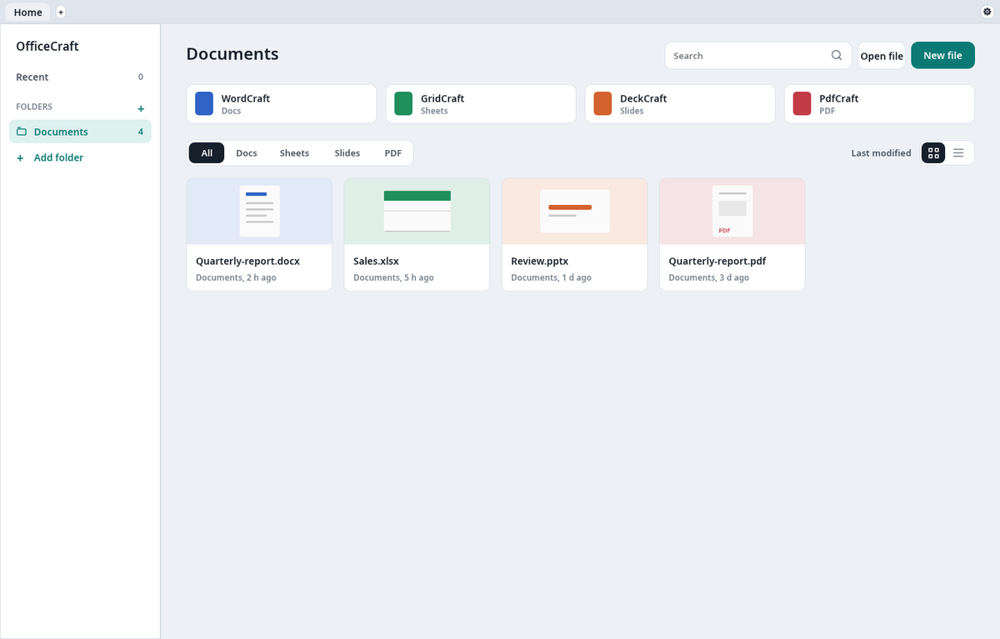
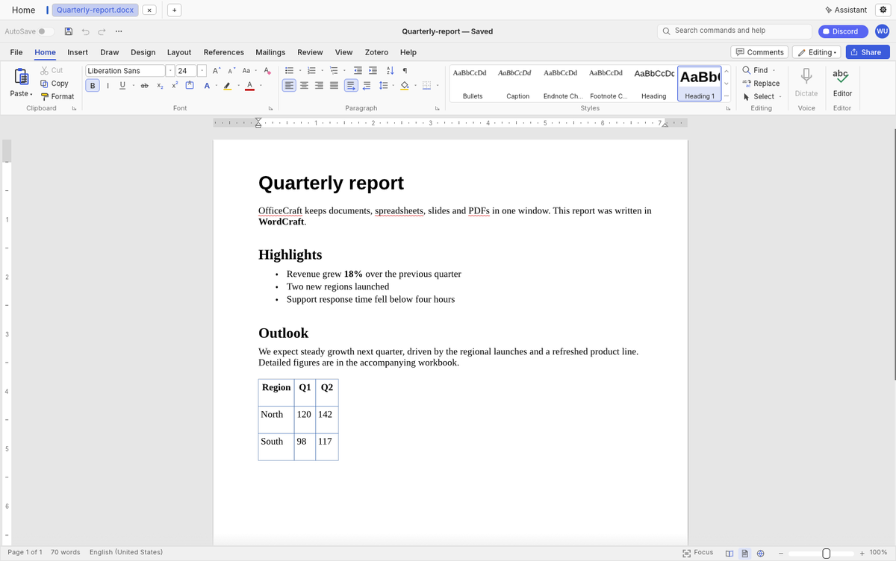
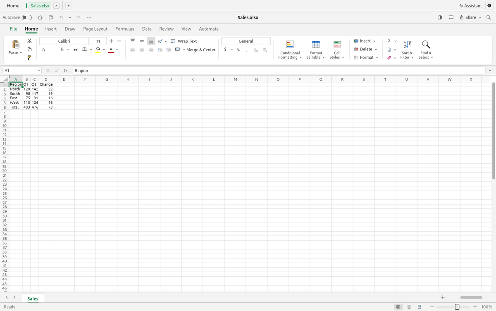
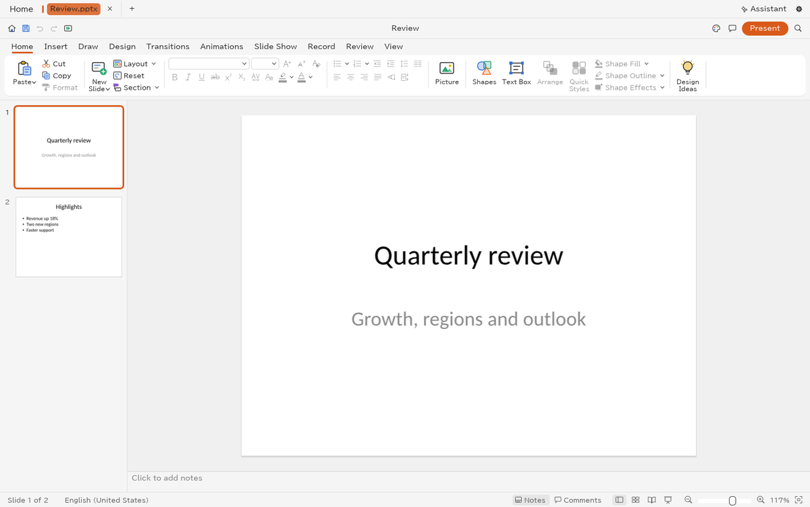
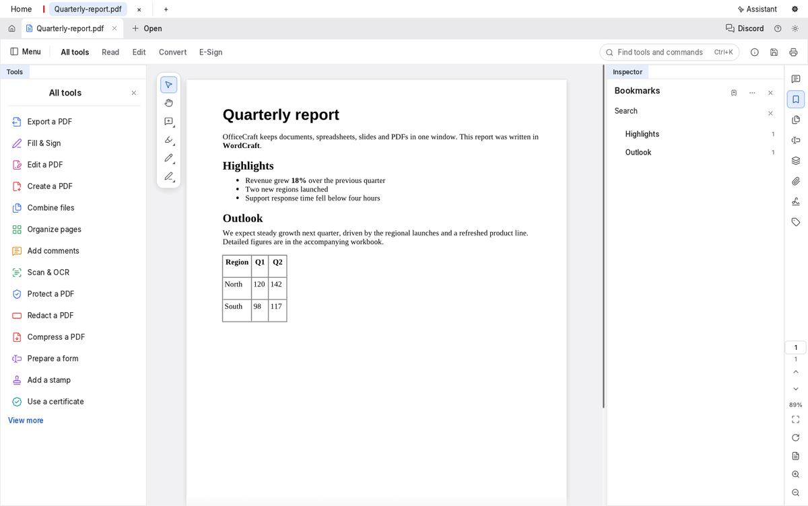

# OfficeCraft

One native window for documents, spreadsheets, slides and PDFs, with a built-in AI assistant.
OfficeCraft is a tabbed shell around four Rust/egui apps:

| App | For | Opens |
|---|---|---|
| **WordCraft** | Docs | `.docx`, `.odt`, `.rtf`, `.md`, `.txt`, `.html` |
| **GridCraft** | Sheets | `.xlsx`, `.csv`, `.tsv` |
| **DeckCraft** | Slides | `.pptx` |
| **PdfCraft** | PDF | `.pdf` |

Each app runs in-process as a tab, so a spreadsheet, the report that cites it and the PDF you
exported from it sit side by side in one window.



| WordCraft | GridCraft |
|---|---|
|  |  |
| **DeckCraft** | **PdfCraft** |
|  |  |

## Install

You need a Rust toolchain (1.90 or newer) and the usual egui/wgpu system libraries.

```sh
git clone https://github.com/shuff57/officecraft
cd officecraft
./install.sh            # builds a release binary and installs under ~/.local
```

This installs `~/.local/bin/officecraft`, a desktop entry and the icons. `PREFIX=/usr/local
./install.sh` installs elsewhere. Set `CRAFT_FONTS_DIR` if your fonts directory is not
`~/craft-fonts`.

### Building against local checkouts

OfficeCraft pulls the four apps from the `storytold` repositories. To build against sibling
checkouts (`../wordcraft`, `../gridcraft`, `../deckcraft`, `../pdfcraft`) instead:

```sh
./install.sh --local
```

or run `scripts/use-local-siblings.sh` once and use plain `cargo build --release`.

> OfficeCraft calls `context_changed()` on each app's `ui-egui` crate. Until that lands in the
> `gridcraft` and `pdfcraft` main branches, a build from the org repos needs a checkout (or fork)
> that has it; point `sources` (below) at one.

## Updates

The ⟳ button in the tab bar opens **Updates**. **Check** compares the newest commit of each app
repository you follow with the one your binary was built from; **Update and rebuild** pulls,
rebuilds in your source checkout, reinstalls and offers to restart.

Which repository and branch each app follows is set in `~/.config/officecraft/sources`, one app
per line (`<app> <git url> [branch]`, default branch `main`):

```
wordcraft https://github.com/shuff57/wordcraft equashion-editor
deckcraft https://github.com/shuff57/deckcraft equashion-editor
gridcraft file:///home/me/src/gridcraft main
```

Apps you leave out follow the org repository. The same works from a terminal:
`scripts/update.sh check` and `scripts/update.sh apply`. The checkout that built the install is
recorded in `~/.local/share/officecraft/install.env`, so run `./install.sh` once to enable
updates. A repository can only be redirected to a *different* URL; to follow another branch of the
org repository, fork it or use a local clone.

## Assistant

The **Assistant** button opens a chat that edits the open file through that app's own agent tools
(the same tool sets the apps expose over MCP). The ⚙ button picks the provider:

- **Local endpoint**: any OpenAI-compatible server (default `http://127.0.0.1:11434/v1`).
- **Ollama Cloud**: `https://ollama.com/v1`, default model `gpt-oss:120b`.
- **OpenRouter**: `https://openrouter.ai/api/v1`, default model `openai/gpt-oss-120b`.

Settings are stored in `~/.config/officecraft/ai.json`. API keys go in a separate owner-only file,
`~/.config/officecraft/ai-keys.json` (mode 0600). `OFFICECRAFT_AI_URL`, `OFFICECRAFT_AI_MODEL`
and `OFFICECRAFT_AI_KEY` override them for one run.

## Development

```sh
scripts/use-local-siblings.sh      # patch the app dependencies with ../<app> checkouts
cargo run --release
cargo test
```

Debug switches: `OFFICECRAFT_SELFTEST=1` cycles every view and exits;
`OFFICECRAFT_SHOT=out.ppm` draws a few frames, saves the window and exits (open files on the
command line first to capture an app tab).

## Licence

Apache-2.0.
