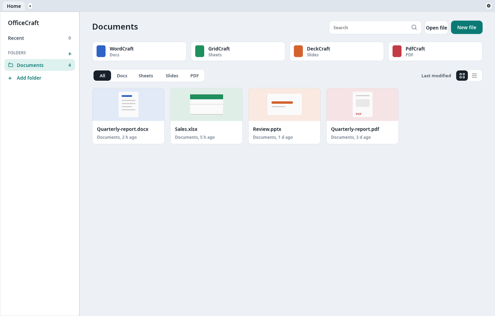
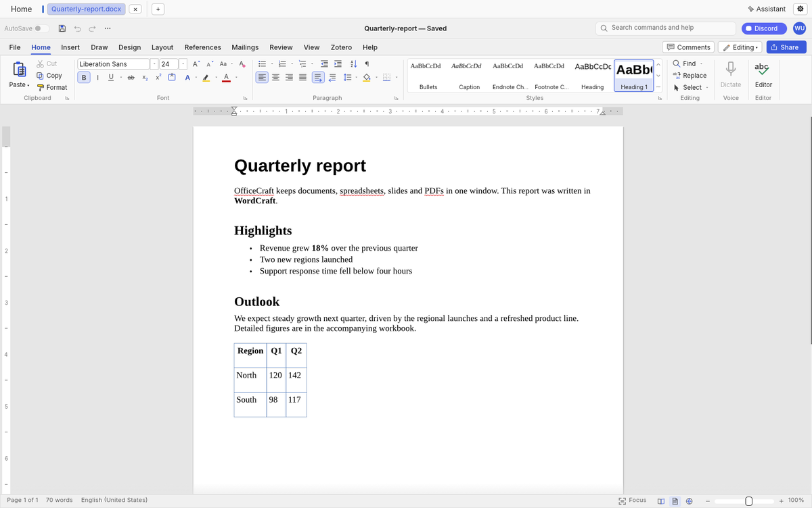
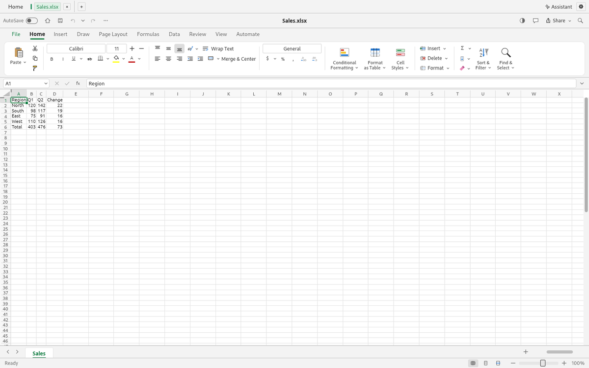
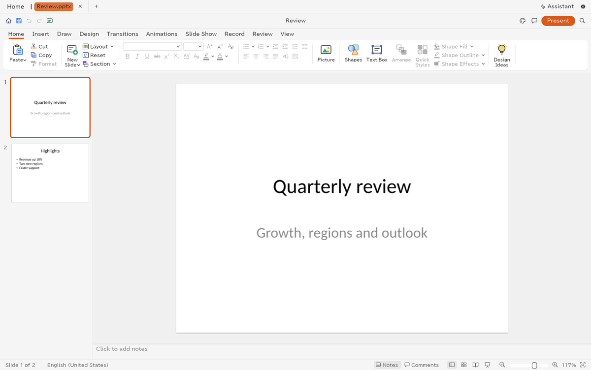
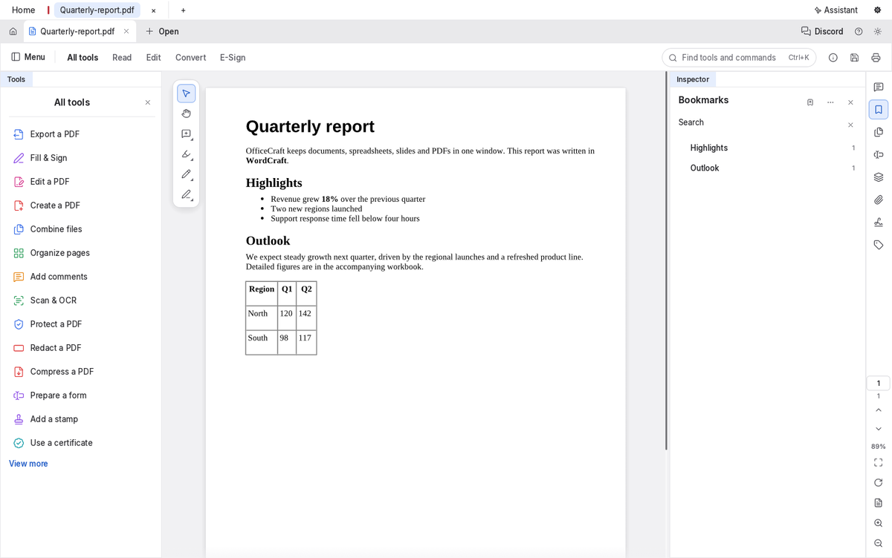

# OfficeCraft

One native window for documents, spreadsheets, slides and PDFs, with a built-in AI assistant.
OfficeCraft is a tabbed shell around four Rust/egui apps:

| App | For | Opens |
|---|---|---|
| **WordCraft** | Docs | `.docx`, `.odt`, `.rtf`, `.md`, `.txt`, `.html` |
| **GridCraft** | Sheets | `.xlsx`, `.csv`, `.tsv` |
| **DeckCraft** | Slides | `.pptx` |
| **PdfCraft** | PDF | `.pdf` |

Each app runs in-process as a tab, so a spreadsheet, the report that cites it and the PDF you
exported from it sit side by side in one window.



| WordCraft | GridCraft |
|---|---|
|  |  |
| **DeckCraft** | **PdfCraft** |
|  |  |

## Install

You need a Rust toolchain (1.90 or newer) and the usual egui/wgpu system libraries.

```sh
git clone https://github.com/shuff57/officecraft
cd officecraft
./install.sh            # builds a release binary and installs under ~/.local
```

This installs `~/.local/bin/officecraft`, a desktop entry and the icons. `PREFIX=/usr/local
./install.sh` installs elsewhere. Set `CRAFT_FONTS_DIR` if your fonts directory is not
`~/craft-fonts`.

### Building against local checkouts

OfficeCraft builds the four apps from their official `storytold` release tags (WordCraft and
DeckCraft v0.18.1, GridCraft v0.19.1, PdfCraft v0.22.0, all egui 0.37); viSHual and verSHion come
from their `v0.2.0-egui037` tags. To build against sibling checkouts (`../wordcraft`,
`../gridcraft`, `../deckcraft`, `../pdfcraft`) instead:

```sh
./install.sh --local
```

or run `scripts/use-local-siblings.sh` once and use plain `cargo build --release`.

Sibling checkouts must be on egui 0.37 like the releases. The apps share one egui context; the
shell puts each app's fonts and style back when its tab comes to the front, so no app needs a
patch for that.

The Equations tab's **Insert into…** puts an equation into an open Docs tab as a real, editable
equation, and into a Slides tab as a picture (DeckCraft has no equation object).

## Updates

The ⟳ button in the tab bar opens **Updates**. **Check** compares the newest commit of each app
repository you follow with the one your binary was built from; **Update and rebuild** pulls,
rebuilds in your source checkout, reinstalls and offers to restart.

Which repository and branch each app follows is set in `~/.config/officecraft/sources`, one app
per line (`<app> <git url> [branch]`, default branch `main`):

```
wordcraft https://github.com/shuff57/wordcraft equashion-editor
deckcraft https://github.com/shuff57/deckcraft equashion-editor
gridcraft file:///home/me/src/gridcraft main
```

Apps you leave out follow the org repository. The same works from a terminal:
`scripts/update.sh check` and `scripts/update.sh apply`. The checkout that built the install is
recorded in `~/.local/share/officecraft/install.env`, so run `./install.sh` once to enable
updates. A repository can only be redirected to a *different* URL; to follow another branch of the
org repository, fork it or use a local clone.

## Assistant

The **Assistant** button opens a chat that edits the open file through that app's own agent tools
(the same tool sets the apps expose over MCP). The ⚙ button picks the provider:

- **Custom endpoint**: any OpenAI-compatible API, with an optional API key: a local server
  (default `http://127.0.0.1:11434/v1`), your own gateway, or a pay-as-you-go service. The Service
  menu fills in DeepSeek, Groq, Together AI, Mistral, Fireworks, Cerebras, Ollama or LM Studio.
- **Ollama Cloud**: `https://ollama.com/v1`, default model `gpt-oss:120b`.
- **OpenRouter**: `https://openrouter.ai/api/v1`, default model `openai/gpt-oss-120b`.
- **Claude Code** (desktop): your own Claude Code and Claude plan. Each message runs `claude -p`,
  which edits the open documents live, step by step, through OfficeCraft's MCP server. Claude Code
  gets no shell and no file tools, only OfficeCraft's. For Claude Code on another computer (a NAS),
  set the command to the ssh command that reaches it, e.g. `ssh my-nas claude` (use the full path
  to `claude` if a non-interactive shell there doesn't find it). OfficeCraft adds
  `-R 7990:127.0.0.1:7990` so the far end can reach it, and nothing listens on the network.

The MCP server listens on `http://127.0.0.1:7990/mcp` (the next free port if that one is taken),
loopback only, and needs a bearer token. Each Claude Code run gets its own token. To use OfficeCraft
from a Claude Code session you start yourself, tick "Also let Claude Code sessions I start myself
work in OfficeCraft" in Settings and run the `claude mcp add …` command shown there. Its token is
kept in `~/.config/officecraft/mcp-token` (mode 0600); New token replaces it. The tools are
`list_tabs`, `app_tools`, `use_tool` (each app's own agent tools), `new_tab`, `open_file`,
`show_tab`, `send_to` and `save`.

On Home, **Make** turns a description into a new document: it picks the app from the words (or the
one you choose) and hands the description to that tab's assistant.

Settings are stored in `~/.config/officecraft/ai.json`. API keys go in a separate owner-only file,
`~/.config/officecraft/ai-keys.json` (mode 0600). `OFFICECRAFT_AI_URL`, `OFFICECRAFT_AI_MODEL`
and `OFFICECRAFT_AI_KEY` override them for one run.

## Files on Home

Add folders in the sidebar and browse them one level at a time; the path above the list goes back
up. Right-click a file or folder to rename it, show it in the file manager, copy its path or move it
to the Trash (the system Trash; where a folder has none, such as a NAS share, OfficeCraft Trash in
the sidebar, with Restore). Drag a file onto a folder, a part of the path or a sidebar folder to move
it; drag sidebar folders and tabs to reorder them. A rename or move follows an open Docs, Sheets or
Slides tab.

Copy and paste between Docs, Sheets and Slides keeps formatting: a Sheets range pastes into Docs as
a table.

**Send to** (right-click a tab, or the Send to menu at the top) makes one app's document into
another's, in a new tab or an open one:
- Docs → Slides takes the outline: the top heading level becomes the slides, with the text under
  each heading as bullets.
- Slides → Docs turns slide titles into headings, text into bullets and speaker notes into body
  text.
- Sheets → Docs or Slides brings the used range over as a table.
- Graph → Docs or Slides inserts the graph as a picture. In Docs it can still be edited.
- Docs, Sheets or Slides → PDF saves a PDF and opens it in a PDF tab.

In the web build, a file in a folder added with the folder picker can be renamed or deleted from its
right-click menu. Delete is permanent, because a browser has no Trash.

With a folder added, the first Save of a new document opens the browser's Save dialog in the folder
shown on Home, and the file appears in that folder. Later Saves of that tab write the same file in
place, even if the app would propose another name. If the dialog is closed, a message says the
document was not saved and the page still warns before you leave. Without an added folder, Save
downloads a copy as before.

Closing the window or restarting after an update asks first when a tab has unsaved work. Docs and
Slides keep recovery copies of unsaved documents in `~/.local/share/officecraft/recovery`; after a
crash they come back on the next launch (`OFFICECRAFT_NO_RECOVERY=1` turns this off).

## Development

```sh
scripts/use-local-siblings.sh      # patch the app dependencies with ../<app> checkouts
cargo run --release
cargo test
```

Debug switches:
- `OFFICECRAFT_SELFTEST=1` cycles every view and exits.
- `OFFICECRAFT_SHOT=out.ppm` draws a few frames, saves the window and exits. Open files on the
  command line first to capture an app tab.
- `OFFICECRAFT_SELFTEST_SENDTO=<dir>` runs every Send to conversion, checks the results, and writes
  the PDFs to `<dir>`.
- `OFFICECRAFT_SELFTEST_AI=<prompt>` sends one message through the assistant and prints the
  transcript.

In the web build, `?test-folder=opfs` adds the page's private storage as a folder named "OPFS"
holding two sample files. Rename, Delete and the first Save of a new document can then be tried
without a picker (the Save dialog is skipped there; the file is written to the folder directly).

## Licence

Apache-2.0.
